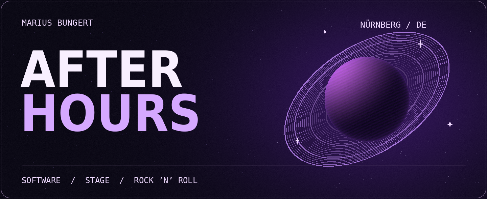

# Hey, I’m Marius.

I study **Informatics at FAU Erlangen-Nürnberg** and work as a full-stack developer with **Angular, TypeScript, Kotlin, and Spring Boot**. After hours, I’m usually at dance practice, in a musical rehearsal, or back at my desk building something.

## Side A · On my desk

| Project | What I built |
| :--- | :--- |
| **EnsembleOS** | A props inventory my musical theatre club uses to remember what we own and which shelf it’s on. |
| **CodePilot** | An AI tutor for beginners learning C#. For my bachelor’s thesis, I explored how to give someone enough of a hint to get unstuck. |
| **CLARITY** | A Windows desktop app for answering “where did all my storage go?” Built with Tauri, Rust, and React. |

I also like working with **Next.js, .NET, and Azure**, especially when I can take a project from its first screen through to deployment.

## Side B · Away from the keyboard

I compete in **acrobatic Rock ’n’ Roll** and perform in musicals. I’ve been skiing since I was two. My coffee habit took a little longer to develop. I blame the bachelor’s thesis.
