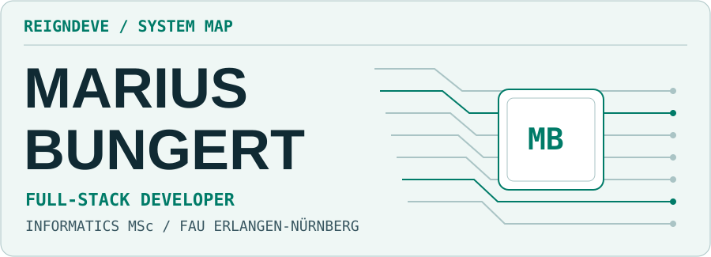
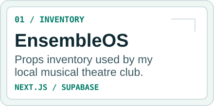
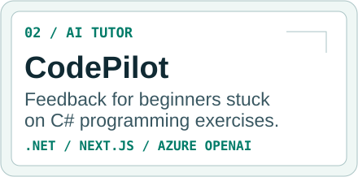
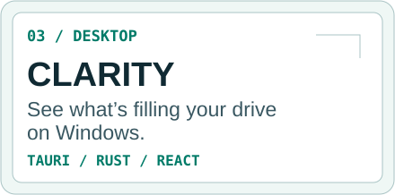
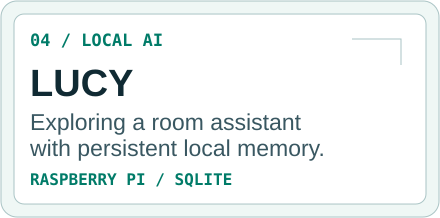

<picture><source media="(prefers-color-scheme: dark)" srcset="assets/hero-dark.svg"></picture>

<picture><source media="(prefers-color-scheme: dark)" srcset="assets/stack-dark.svg"></picture>

<picture><source media="(prefers-color-scheme: dark)" srcset="assets/projects-dark.svg"></picture>

<p align="center">
<picture><source media="(prefers-color-scheme: dark)" srcset="assets/card-1-dark.svg"></picture>
<picture><source media="(prefers-color-scheme: dark)" srcset="assets/card-2-dark.svg"></picture>
</p>

<p align="center">
<picture><source media="(prefers-color-scheme: dark)" srcset="assets/card-3-dark.svg"></picture>
<picture><source media="(prefers-color-scheme: dark)" srcset="assets/card-4-dark.svg"></picture>
</p>

<details>
<summary><picture><source media="(prefers-color-scheme: dark)" srcset="assets/terminal-dark.svg"></picture></summary>

```text
$ whoami --verbose
name       Marius Bungert
location   Nuremberg area, Germany
focus      full-stack development / local AI
offline    competitive acrobatic rock ’n’ roll
since      skiing at age 2
coffee     enabled during the bachelor’s thesis
```

</details>
